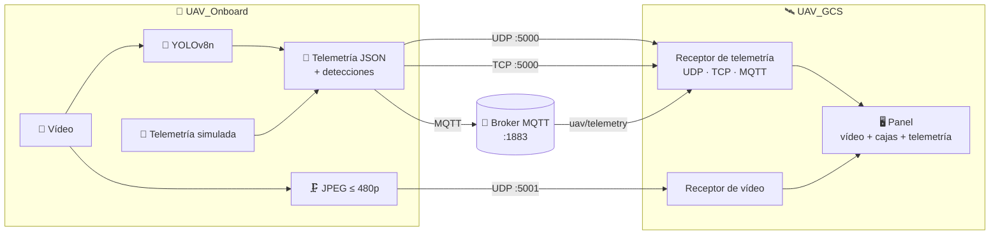

<div align="center">

# 🚁 ⇄ 🛰️ UAV — Detección en el edge y estación de tierra

**Sistema completo de dron + estación de tierra: el dron detecta objetos con IA a bordo y envía en tiempo real la telemetría, el vídeo y las detecciones a tierra.**


</div>

---

## ✨ Qué es

El repositorio contiene **dos sistemas independientes**. Los dos usan **arquitectura hexagonal** y se comunican mediante un contrato de red común:

| | Proyecto | Qué hace | Tecnología |
|---|---|---|---|
| 🚁 | **[UAV_Onboard](UAV_Onboard)** — *Sistema A* | Software de a bordo: captura vídeo, detecta objetos con **YOLOv8n** en CPU y envía la telemetría y el vídeo a tierra. No tiene interfaz; se configura con `config.json` | C++17 · ONNX Runtime · OpenCV · libmosquitto · Docker |
| 🛰️ | **[UAV_GCS](UAV_GCS)** — *Sistema B* | Estación de tierra: recibe la telemetría y el vídeo y los muestra en un panel con las cajas de detección superpuestas | C++17 · Qt 6 Widgets · libmosquitto |



---

## 🔌 Contrato de red

| Canal | Transporte | Puerto / topic | Formato |
|---|---|---|---|
| 📡 Telemetría | **UDP**, **TCP** o **MQTT**, a elegir | `5000`, o broker `1883` con topic `uav/telemetry` | JSON con batería, velocidad, altura, GPS y detecciones |
| 🎥 Vídeo | siempre **UDP** | `5001` | 1 datagrama = 1 frame JPEG |

El formato completo (framing TCP, claves JSON, coordenadas normalizadas…) está documentado en los README de cada proyecto.

---

## ⚡ Demo rápida (UDP, todo en el mismo PC)

> Antes, compila los dos proyectos siguiendo sus README: [UAV_GCS → Puesta en marcha](UAV_GCS/README.md#-puesta-en-marcha) y [UAV_Onboard → Puesta en marcha](UAV_Onboard/README.md#-puesta-en-marcha).

**1.** Lanza el dron. El `config.json` por defecto ya apunta a `127.0.0.1` por UDP:

```powershell
cd UAV_Onboard\out\build\x64-Release
.\UAV_Onboard.exe
```

**2.** Lanza la estación de tierra:

```powershell
.\UAV_GCS\out\build\x64-Release\UAV_GCS.exe
```

**3.** Deja `127.0.0.1:5000` y **UDP**, y pulsa **"Conectar al Dron"**. 🎉 Se abre el panel con el vídeo, las cajas de detección y la telemetría en directo.

> 🔀 Para probar **TCP**, **MQTT** o el dron dentro de **Docker** (con recursos limitados o emulando ARM64), consulta [la demo completa de UAV_Onboard](UAV_Onboard/README.md#-demo-completa-dron--estación-de-tierra).

---

## 📁 Estructura del repositorio

```
UAV/
├── UAV_Onboard/    🚁 Sistema A: dron (detección + envío)     → README propio
└── UAV_GCS/        🛰️ Sistema B: estación de tierra (Qt)      → README propio
```

---

<div align="center">

**Autor:** Jesús David Calvente Zapata

</div>
