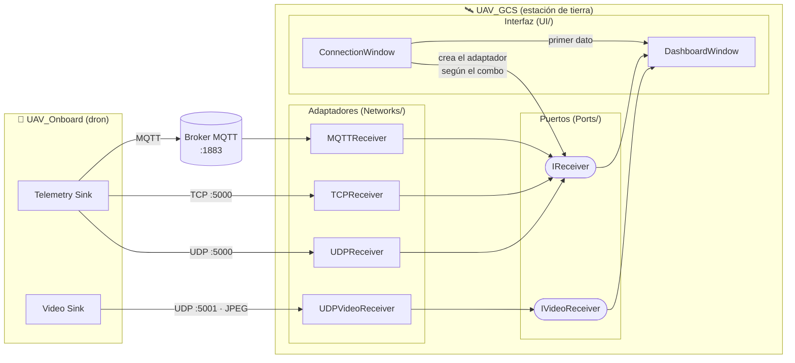
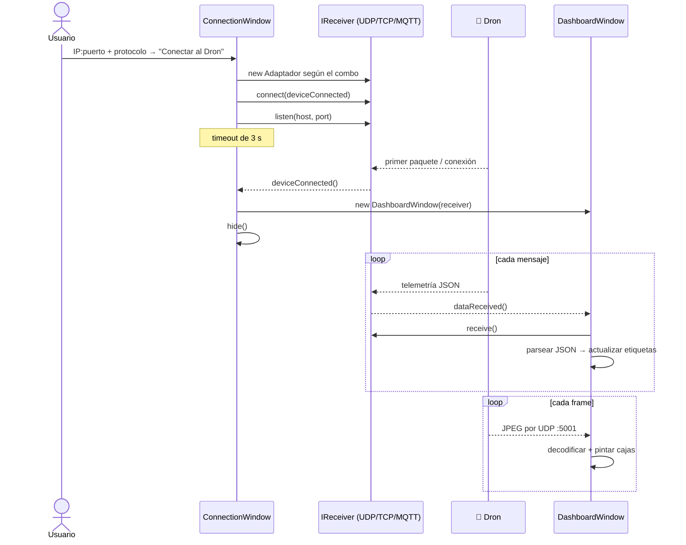

<div align="center">

# 🛰️ UAV_GCS — Estación de Tierra

**Ground Control Station para recibir en tiempo real la telemetría, el vídeo y las detecciones de IA de un dron.**


</div>

---

## ✨ Qué es

`UAV_GCS` es el **Sistema B** del proyecto UAV: la aplicación de escritorio que se queda en tierra.
Su pareja es [`UAV_Onboard`](../UAV_Onboard), el software que va a bordo del dron y que:

1. captura vídeo,
2. detecta objetos con **YOLOv8n** (ONNX Runtime),
3. y envía todo a tierra.

La estación de tierra recibe dos flujos independientes y los presenta en un único panel:

| Canal | Contenido | Transporte | Puerto |
|---|---|---|---|
| 📡 **Telemetría** | batería, velocidad, altura, GPS y detecciones (JSON) | **UDP, TCP o MQTT**, a elegir | `5000` (o `1883` para el broker MQTT) |
| 🎥 **Vídeo** | frames JPEG | siempre **UDP** | `5001` |

### Funcionalidades

- 🔌 **Tres protocolos de telemetría** que se pueden cambiar desde la interfaz: UDP, TCP o MQTT.
- 🎥 **Vídeo en directo**, con las **cajas de detección dibujadas encima** del frame.
- 🏷️ **80 clases COCO traducidas al español** ("Persona", "Coche", "Bicicleta"…), embebidas en el binario.
- 📊 **Panel de telemetría**: batería, velocidad, altura, coordenadas GPS y latencia estimada.
- 🐕 **Watchdogs** independientes para telemetría (2 s) y vídeo (1 s), que avisan si se pierde la señal.
- 🧱 **Arquitectura hexagonal**: la interfaz solo conoce los *puertos* y nunca un socket concreto.

---

## 🖥️ Cómo se ve

La aplicación tiene dos ventanas que se encadenan:

```
┌─────────────── Ventana de Inicio ───────────────┐
│                                                 │
│  IP del Dron:       [ 127.0.0.1:5000        ]   │
│  Tipo de conexión:  [ UDP ▾ ]  UDP/TCP/MQTT     │
│                                                 │
│            [   Conectar al Dron   ]             │
│                                                 │
└─────────────────────────────────────────────────┘
                        │  primer dato recibido
                        ▼
┌──────────────────── Ventana de Telemetría (pantalla completa) ───────────────────┐
│ ┌──────────────────────────────────────────────────┐  Batería: 87.4 %            │
│ │                                                  │  Velocidad: 12.3 m/s        │
│ │     ┌─Persona 91%─┐                              │  Altura: 54 m               │
│ │     │             │        ┌─Coche 78%──┐        │  GPS: 40.4168,-3.7038       │
│ │     │             │        │            │        │                             │
│ │     └─────────────┘        └────────────┘        │  Últimas detecciones:       │
│ │                                                  │  ┌───────────────────────┐  │
│ │              VÍDEO EN DIRECTO + CAJAS            │  │ Clase Persona (91%)   │  │
│ │                                                  │  │ Clase Coche (78%)     │  │
│ └──────────────────────────────────────────────────┘  └───────────────────────┘  │
│ Estado: Conectado                                                                │
│ Latencia: 12 ms                                       [        Salir        ]    │
└──────────────────────────────────────────────────────────────────────────────────┘
```

---

## 🏗️ Arquitectura

El proyecto sigue una **arquitectura hexagonal (puertos y adaptadores)**.
La interfaz gráfica habla solo con dos puertos abstractos.
Cada protocolo de red es un adaptador intercambiable que implementa uno de esos puertos.



### Puertos

| Puerto | Responsabilidad | Señales |
|---|---|---|
| `IReceiver` | Telemetría: `listen(host, port)`, `isListening()`, `stop()` y `receive()` | `deviceConnected()`, `dataReceived()` |
| `IVideoReceiver` | Vídeo: `listen(port)` y `stop()` | `frameReceived(QByteArray)` |

### Adaptadores

| Adaptador | Rol de red | Se considera "conectado" cuando… | Detalles |
|---|---|---|---|
| `UDPReceiver` | servidor pasivo en cualquier interfaz | llega el primer datagrama | Vacía la cola y se queda con el datagrama **más reciente**, para minimizar la latencia |
| `TCPReceiver` | servidor que acepta un solo cliente a la vez | se acepta la conexión | Reensambla los mensajes con un prefijo de longitud `uint32` big-endian |
| `MQTTReceiver` | cliente del broker | se completa la conexión y la suscripción | Usa `libmosquitto` en un hilo propio y pasa cada mensaje al hilo de Qt con `QueuedConnection` |
| `UDPVideoReceiver` | servidor pasivo en el puerto `5001` | — | Cada datagrama es un frame JPEG completo |

### Flujo de conexión



---

## 📜 Contrato de protocolo

### Telemetría

| Transporte | Endpoint | Formato de cada mensaje |
|---|---|---|
| UDP | `:5000` | 1 datagrama = 1 objeto JSON |
| TCP | `:5000` | `[uint32 big-endian: longitud][payload JSON]` |
| MQTT | broker `:1883`, topic `uav/telemetry`, QoS 1 | payload = JSON |

```json
{
  "timestamp": 1788795430709,
  "bateria": 99.99,
  "velocidad": 13.00,
  "altura": 50.25,
  "coordenadas": "40.416805,-3.703700",
  "detecciones": [
    { "class_id": 0, "confidence": 0.9132,
      "x": 0.533088, "y": 0.675817, "width": 0.045588, "height": 0.097386 }
  ]
}
```

| Clave | Significado |
|---|---|
| `timestamp` | momento del envío en ms desde epoch; se usa para calcular la latencia |
| `bateria` | porcentaje de batería (0–100) |
| `velocidad` | velocidad en m/s |
| `altura` | altura en metros |
| `coordenadas` | posición en formato `"lat,lon"` |
| `detecciones[].class_id` | índice de clase COCO (0–79) |
| `detecciones[].confidence` | confianza de la detección (0–1) |
| `detecciones[].x / y / width / height` | caja **normalizada (0–1)** respecto al frame, para que cuadre a cualquier resolución de vídeo |

### Vídeo

Cada datagrama UDP que llega al puerto `5001` contiene **un frame JPEG completo**: reescalado a ≤ 480p y de menos de 60 KB.

---

## 🚀 Puesta en marcha

### 1. Requisitos

| Herramienta | Versión / ruta esperada |
|---|---|
| Windows | 10 / 11 x64 |
| Visual Studio 2022 | con la carga de trabajo **"Desarrollo para el escritorio con C++"**, que incluye CMake y Ninja |
| Qt | **6.11.2 MSVC 2022 64-bit**, en `C:/Qt/6.11.2/msvc2022_64` |
| vcpkg | en `C:/vcpkg` |
| Mosquitto (librería) | instalado mediante vcpkg (ver paso 2) |

> 💡 Si Qt o vcpkg están en otra ruta, cambia `CMAKE_PREFIX_PATH` y `CMAKE_TOOLCHAIN_FILE` en [`CMakeLists.txt`](CMakeLists.txt), o pásalos con `-D` al configurar.

### 2. Instalar la dependencia MQTT

```powershell
C:\vcpkg\vcpkg.exe install mosquitto:x64-windows
```

### 3. Compilar

**Opción A — Visual Studio (recomendada)**

1. `Archivo → Abrir → Carpeta…` y selecciona `UAV_GCS/`.
2. Visual Studio detecta `CMakeLists.txt` y `CMakeSettings.json`. Elige la configuración **x64-Debug** o **x64-Release**.
3. Selecciona `UAV_GCS.exe` como elemento de inicio y pulsa ▶️.

**Opción B — Línea de comandos**

Lanza estos comandos desde **"x64 Native Tools Command Prompt for VS 2022"**:

```powershell
cd UAV_GCS
cmake -S . -B out/build/x64-Release -G Ninja -DCMAKE_BUILD_TYPE=Release
cmake --build out/build/x64-Release
```

### 4. Desplegar las DLL de Qt

Si ejecutas el `.exe` fuera de Visual Studio y aparece un error de DLL de Qt que no se encuentra:

```powershell
C:\Qt\6.11.2\msvc2022_64\bin\windeployqt.exe out\build\x64-Release\UAV_GCS.exe
```

> La DLL de Mosquitto la copia vcpkg automáticamente junto al ejecutable.

### 5. Ejecutar

```powershell
.\out\build\x64-Release\UAV_GCS.exe
```

> 🔥 La primera vez, el **Firewall de Windows** pedirá permiso para la app. Acéptalo para redes privadas: si no, no llegarán paquetes del dron que corre en Docker o en otra máquina.

---

## 🎮 Cómo conectar con el dron

El campo **"IP del Dron"** acepta el formato `host:puerto`. Si no indicas puerto, se usa `5000`.

| Protocolo | Qué escribir en el campo | Quién arranca primero |
|---|---|---|
| **UDP** | `127.0.0.1:5000`. Solo cuenta el puerto, porque se escucha en todas las interfaces | Arranca el **dron** y después pulsa *Conectar*. El panel se abre al llegar el primer datagrama |
| **TCP** | `127.0.0.1:5000`. Solo cuenta el puerto | Pulsa *Conectar* y **en menos de 3 s** arranca el **dron**, que es quien se conecta a la estación |
| **MQTT** | `IP_DEL_BROKER:1883` | Arranca el **broker**, pulsa *Conectar* (el panel se abre al suscribirse) y arranca el **dron** |

El vídeo no necesita configuración: siempre se escucha en **UDP `5001`**.

### Levantar un broker MQTT en un momento

```powershell
docker run -it --rm -p 1883:1883 eclipse-mosquitto:2 mosquitto -c /mosquitto-no-auth.conf
```

### Probar sin dron

Este script de Python envía telemetría falsa por UDP a 10 Hz. Sirve para comprobar que la estación funciona por sí sola: elige **UDP**, lanza el script y pulsa *Conectar*.

```python
# fake_drone.py
import json, math, socket, time

sock = socket.socket(socket.AF_INET, socket.SOCK_DGRAM)
t = 0.0
while True:
    msg = {
        "timestamp": int(time.time() * 1000),
        "bateria": max(0.0, 100 - t),
        "velocidad": 10 + 3 * math.cos(t),
        "altura": 50 + 5 * math.sin(t),
        "coordenadas": f"{40.4168 + 0.001*math.sin(t):.6f},{-3.7038 + 0.001*math.cos(t):.6f}",
        "detecciones": [
            {"class_id": 0, "confidence": 0.91, "x": 0.30, "y": 0.30, "width": 0.15, "height": 0.40}
        ],
    }
    sock.sendto(json.dumps(msg).encode(), ("127.0.0.1", 5000))
    t += 0.1
    time.sleep(0.1)
```

> Sin vídeo, el panel mostrará "SEÑAL DE VÍDEO PERDIDA". Es lo esperado. Para ver vídeo y cajas reales, lanza [`UAV_Onboard`](../UAV_Onboard).

---

## 📁 Estructura del proyecto

```
UAV_GCS/
├── CMakeLists.txt              # Build: Qt6 Widgets + Network, libmosquitto
├── CMakeSettings.json          # Configuraciones x64-Debug / x64-Release de Visual Studio
├── Doxyfile                    # Documentación técnica → docs/
├── Includes/
│   ├── Domain/
│   │   ├── Common.hpp          # ImageData, Detection, TelemetryData (solo STL)
│   │   └── Protocol.hpp        # enum Protocol { UDP, TCP, MQTT }
│   ├── Ports/
│   │   ├── IReceiver.hpp       # Puerto de telemetría
│   │   └── IVideoReceiver.hpp  # Puerto de vídeo
│   ├── Networks/               # Adaptadores
│   │   ├── UDPReceiver.hpp
│   │   ├── TCPReceiver.hpp
│   │   ├── MQTTReceiver.hpp
│   │   └── UDPVideoReceiver.hpp
│   └── UI/
│       ├── ConnectionWindow.hpp
│       └── DashboardWindow.hpp
├── src/                        # Implementaciones (misma estructura)
│   └── main.cpp                # Punto de entrada: QApplication + ConnectionWindow
└── Resources/
    ├── resources.qrc
    └── coco_classes.json       # 80 clases COCO en español, embebidas en el binario
```

---

## 📚 Documentación técnica

Todo el código está documentado con comentarios **Doxygen** en español. Para generar la documentación HTML:

```powershell
cd UAV_GCS
doxygen Doxyfile
start docs\html\index.html
```

---

<div align="center">

**Autor:** Jesús David Calvente Zapata

Parte del proyecto **UAV**: [`UAV_Onboard`](../UAV_Onboard) 🚁 ⇄ 🛰️ `UAV_GCS`

</div>
