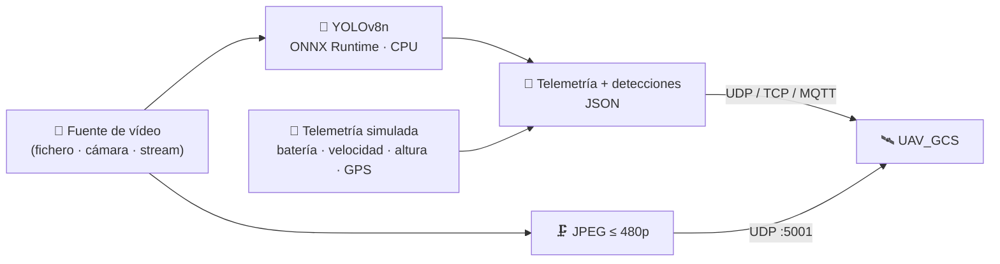
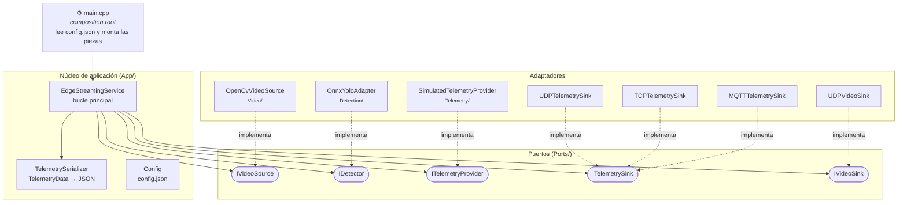
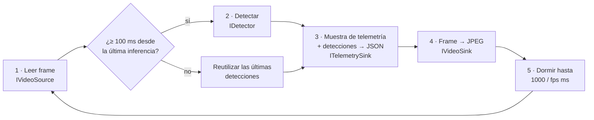
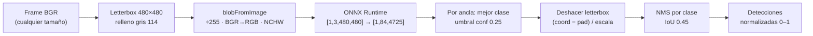
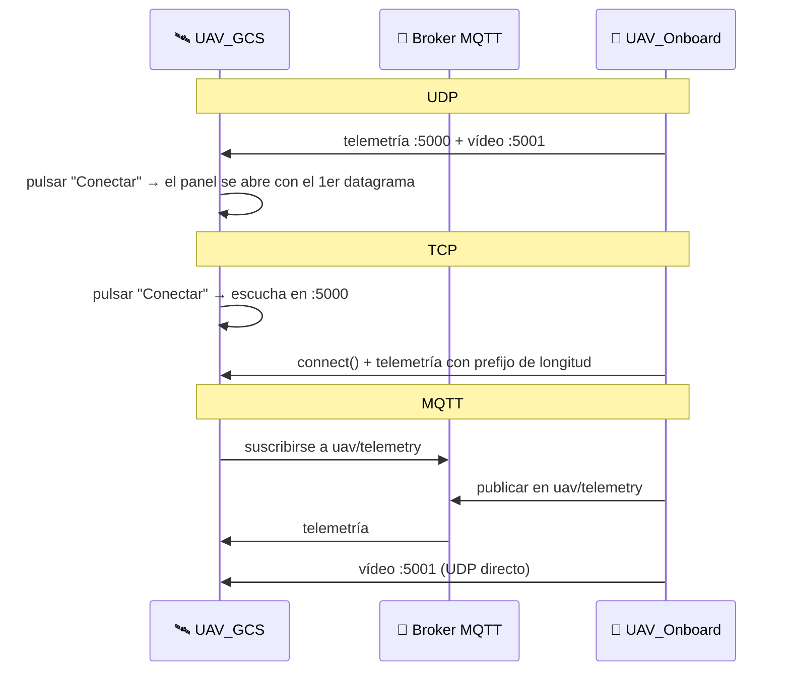

<div align="center">

# 🚁 UAV_Onboard — Sistema Embarcado

**Software de a bordo del dron: captura vídeo, detecta objetos con IA en el propio dispositivo (*edge*) y envía la telemetría y el vídeo a la estación de tierra.**


</div>

---

## ✨ Qué es

`UAV_Onboard` es el **Sistema A** del proyecto UAV: el programa que se ejecuta **dentro del dron**.
No tiene interfaz gráfica. Se configura con un único `config.json` y se ejecuta en bucle hasta que recibe una señal de parada.

Su pareja es [`UAV_GCS`](../UAV_GCS), la estación de tierra que muestra todo lo que el dron envía.



### Funcionalidades

- 🧠 **Inferencia en el edge** con **YOLOv8n** sobre **ONNX Runtime** en CPU, usando un solo hilo pensado para hardware limitado.
- 🎯 **Pipeline de detección completo**:
  - preprocesado *letterbox*,
  - inferencia,
  - decodificación de la salida YOLOv8,
  - **NMS por clase**,
  - coordenadas **normalizadas (0–1)**.
- 📡 **Tres transportes de telemetría** que se eligen desde `config.json`: **UDP, TCP y MQTT**.
- 🎥 **Vídeo JPEG por UDP**, con **calidad autocalibrada** para que cada frame quepa en un solo datagrama.
- 🔋 **Telemetría simulada** y realista: la batería se descarga, y la altura, la velocidad y la posición GPS oscilan.
- 🐳 **Imagen Docker multi-arquitectura** (amd64 / arm64), lista para limitar CPU y memoria y simular el hardware del dron.
- 🛑 **Apagado limpio** con `Ctrl+C` o `docker stop` (SIGINT / SIGTERM).
- 🧱 **Arquitectura hexagonal**: el bucle principal solo conoce interfaces. Cambiar de modelo, de transporte o de cámara no exige tocarlo.

---

## 🏗️ Arquitectura

El sistema sigue una arquitectura **hexagonal (puertos y adaptadores)**:

- **`main.cpp`** es el *composition root*, el único sitio que conoce las clases concretas.
- **`EdgeStreamingService`** es el núcleo y solo depende de los cinco puertos.



### Puertos

| Puerto | Contrato | Adaptador actual |
|---|---|---|
| `IVideoSource` | `open(source)`, `isOpened()`, `read(ImageData&)` y `close()` | `OpenCvVideoSource`: fichero, índice de cámara o URL. Vuelve al principio al terminar el vídeo |
| `IDetector` | `loadModel(path)`, `isLoaded()` y `detect(ImageData) → vector<Detection>` | `OnnxYoloAdapter`: YOLOv8n con ONNX Runtime |
| `ITelemetryProvider` | `sampleTelemetry() → TelemetryData` | `SimulatedTelemetryProvider` |
| `ITelemetrySink` | `start(host, port)`, `publish(json)` y `stop()` | `UDPTelemetrySink`, `TCPTelemetrySink` y `MQTTTelemetrySink` |
| `IVideoSink` | `start(host, port)`, `publish(ImageData)` y `stop()` | `UDPVideoSink`: JPEG por UDP |

### El bucle principal



Todo se ejecuta en **un único hilo**. Es una decisión deliberada: el sistema está pensado para medio núcleo de CPU y para un posible paso futuro a un RTOS.

---

## 🧠 Detección con YOLOv8n

Cada llamada a `OnnxYoloAdapter::detect()` sigue estos pasos:



| Parámetro | Valor |
|---|---|
| Modelo | `yolov8n_480.onnx` (FP32) |
| Entrada | `[1, 3, 480, 480]` |
| Salida | `[1, 84, 4725]`: 4 valores de caja y 80 clases COCO |
| Umbral de confianza | `0.25` |
| Umbral IoU (NMS) | `0.45` |
| Hilos de inferencia | `1` |

> 📉 **Por qué 480 px y no 640:** se midieron tres variantes en las mismas condiciones.
> - Bajar la entrada de 640 a 480 px reduce la latencia de inferencia **~40–50 %**.
> - La versión cuantizada a **INT8** no dio una mejora neta en latencia y memoria que justificara usarla.

### Modelos incluidos (`Models/`)

| Fichero | Tamaño | Uso |
|---|---|---|
| `yolov8n_480.onnx` | 12.2 MB | ✅ **Modelo en uso** (entrada de 480 px) |
| `yolov8n.onnx` | 12.3 MB | Versión de 640 px (referencia) |
| `yolov8n_int8.onnx` | 3.4 MB | Cuantizado INT8 (experimento) |
| `yolov8n.pt` | 6.2 MB | Pesos originales de PyTorch / Ultralytics |
| `video.mp4` | 74.2 MB | Vídeo de muestra que se usa como "cámara" |

---

## 📜 Contrato de protocolo

El dron es siempre el **emisor**:

- **UDP:** envía directamente a la estación de tierra.
- **TCP:** **se conecta** a la estación de tierra, que actúa como servidor.
- **MQTT:** publica en un broker al que también está suscrita la estación.

| Canal | Transporte | Destino | Formato de cada mensaje |
|---|---|---|---|
| 📡 Telemetría | UDP | `host:5000` | 1 datagrama = 1 objeto JSON |
| 📡 Telemetría | TCP | `host:5000` | `[uint32 big-endian: longitud][payload JSON]` |
| 📡 Telemetría | MQTT | broker `:1883`, topic `uav/telemetry`, QoS 1 | payload = JSON |
| 🎥 Vídeo | UDP | `host:5001` | 1 datagrama = 1 frame JPEG (≤ 480p, < 60 KB) |

Ejemplo de mensaje de telemetría:

```json
{
  "timestamp": 1788795430709,
  "bateria": 99.99,
  "velocidad": 13.00,
  "altura": 50.25,
  "coordenadas": "40.416805,-3.703700",
  "detecciones": [
    { "class_id": 2, "confidence": 0.3819,
      "x": 0.533088, "y": 0.675817, "width": 0.045588, "height": 0.097386 }
  ]
}
```

Las cajas de `detecciones` van **normalizadas entre 0 y 1** respecto al frame original. Así la estación de tierra las dibuja bien sea cual sea la resolución del vídeo que reciba.

---

## ⚙️ Configuración (`config.json`)

El programa lee `config.json` del **directorio de trabajo**. Todas las claves son opcionales: si falta alguna, se usa su valor por defecto.

```json
{
  "transporte": "udp",
  "host": "127.0.0.1",
  "puerto_telemetria": 5000,
  "puerto_video": 5001,
  "modelo": "Models/yolov8n_480.onnx",
  "fuente_video": "Models/video.mp4",
  "fps_video": 20,
  "latitud_inicial": 40.4168,
  "longitud_inicial": -3.7038,
  "mqtt_topic": "uav/telemetry"
}
```

| Clave | Descripción |
|---|---|
| `transporte` | `"udp"`, `"tcp"` o `"mqtt"` |
| `host` | **IPv4 literal** de destino. En UDP y TCP es la IP de la estación de tierra; en MQTT, la IP del broker |
| `puerto_telemetria` | `5000` en UDP y TCP; `1883` (puerto del broker) en MQTT |
| `puerto_video` | Puerto UDP de vídeo de la estación (`5001`) |
| `modelo` | Ruta al `.onnx` |
| `fuente_video` | Ruta a un fichero, índice de cámara (`"0"`) o URL de stream |
| `fps_video` | Ritmo objetivo del bucle, en fotogramas por segundo |
| `latitud_inicial` / `longitud_inicial` | Punto de partida del GPS simulado |
| `mqtt_topic` | Topic donde se publica la telemetría |

### Ejemplos por transporte

| Escenario | `transporte` | `host` | `puerto_telemetria` |
|---|---|---|---|
| UDP, todo en el mismo PC | `"udp"` | `"127.0.0.1"` | `5000` |
| TCP, todo en el mismo PC | `"tcp"` | `"127.0.0.1"` | `5000` |
| MQTT, con broker en el mismo PC que la estación | `"mqtt"` | `"127.0.0.1"` | `1883` |
| Dron en Docker y estación en Windows | cualquiera | IP LAN del PC, p. ej. `"192.168.1.40"` | según el transporte |

---

## 🚀 Puesta en marcha

Hay dos formas de lanzar el dron:

- **🪟 Windows nativo**: para desarrollar y depurar.
- **🐳 Docker**: para simular el hardware limitado del dron, en x86 o ARM.

### 🪟 Opción 1 — Windows (Visual Studio)

#### Requisitos

| Herramienta | Ruta esperada |
|---|---|
| Visual Studio 2022 | carga de trabajo **"Desarrollo para el escritorio con C++"** |
| OpenCV 4.x (build oficial de Windows) | `C:/opencv/build` |
| ONNX Runtime (release de Windows x64) | `C:/onnxruntime`, con `include/` y `lib/` |
| vcpkg | `C:/vcpkg` |

```powershell
C:\vcpkg\vcpkg.exe install mosquitto:x64-windows
```

> 💡 Las rutas se pueden cambiar sin editar el CMake: `-DOpenCV_DIR=...`, `-DORT_DIR=...` y `-DCMAKE_TOOLCHAIN_FILE=...`.
> Añade `C:\opencv\build\x64\vc16\bin` al `PATH` para que el ejecutable encuentre la DLL de OpenCV.

#### Compilar y ejecutar

**Desde Visual Studio:** `Archivo → Abrir → Carpeta…`, selecciona `UAV_Onboard/`, elige **x64-Release** y lanza `UAV_Onboard.exe` ▶️.

**Desde la línea de comandos** ("x64 Native Tools Command Prompt for VS 2022"):

```powershell
cd UAV_Onboard
cmake -S . -B out/build/x64-Release -G Ninja -DCMAKE_BUILD_TYPE=Release
cmake --build out/build/x64-Release
cd out/build/x64-Release
.\UAV_Onboard.exe
```

Al compilar, CMake **copia automáticamente** junto al ejecutable:

- las DLL de ONNX Runtime,
- la carpeta `Models/`,
- y `config.json`.

Por eso hay que lanzarlo **desde su propia carpeta**. Si editas el `config.json` de esa carpeta, no hace falta recompilar.

Salida esperada:

```
[INFO] Iniciando Sistema de Vuelo - Core IA...
[INFO] Adaptador ONNX: Modelo cargado (Models/yolov8n_480.onnx)
[INFO] Calidad JPEG calibrada a 55
[EXITO] Todo listo. Transporte: udp | Video: 20 fps
```

Para detenerlo, pulsa `Ctrl+C`.

### 🐳 Opción 2 — Docker (simulación del dron)

El `Dockerfile` usa dos fases:

1. **Compilación**: Ubuntu 22.04 con OpenCV y ONNX Runtime 1.17.1.
2. **Ejecución**: una imagen ligera que solo contiene el binario, las librerías, `Models/` y `config.json`.

```powershell
cd UAV_Onboard
docker build -t uav-onboard .
```

Lanza el contenedor **limitando los recursos** como en un dron real. Montar tu `config.json` permite cambiar el transporte o la IP sin reconstruir la imagen:

```powershell
docker run --rm -it `
  --cpus=0.5 --memory=256m `
  -v ${PWD}/config.json:/app/config.json `
  uav-onboard
```

> ⚠️ Dentro del contenedor, `127.0.0.1` es **el propio contenedor**. En `host` pon la **IP LAN** del PC donde corre `UAV_GCS` (`ipconfig` → "Dirección IPv4"). Tiene que ser una IP numérica, no un nombre de host.

Para parar el contenedor, usa `docker stop`. El dron hace un apagado limpio en 1–2 s.

#### 🦾 Emulación ARM64 (QEMU)

`docker buildx` usa QEMU por debajo para generar y ejecutar una imagen **arm64**, como la que llevaría el ordenador de a bordo de un dron real:

```powershell
docker buildx build --platform linux/arm64 -t uav-onboard:arm64 --load .
docker run --rm -it --platform linux/arm64 `
  --cpus=0.5 --memory=256m `
  -v ${PWD}/config.json:/app/config.json `
  uav-onboard:arm64
```

> Bajo emulación todo va bastante más lento, sobre todo la inferencia. Es lo esperado: sirve para validar que el binario funciona en ARM, no para medir rendimiento.

---

## 🎬 Demo completa (dron + estación de tierra)



| Transporte | Orden de arranque |
|---|---|
| **UDP** | 1. Lanza `UAV_Onboard`. 2. En `UAV_GCS` elige **UDP** y pulsa *Conectar* |
| **TCP** | 1. En `UAV_GCS` elige **TCP** y pulsa *Conectar*. 2. Lanza `UAV_Onboard` **en menos de 3 s** |
| **MQTT** | 1. Levanta el broker. 2. En `UAV_GCS` elige **MQTT**, escribe `IP_BROKER:1883` y pulsa *Conectar*. 3. Lanza `UAV_Onboard` |

Para levantar un broker Mosquitto en un momento:

```powershell
docker run -it --rm -p 1883:1883 eclipse-mosquitto:2 mosquitto -c /mosquitto-no-auth.conf
```

> 🎥 En modo MQTT el vídeo sigue yendo **por UDP directo** a `host:5001`. Para que llegue, ejecuta el broker en la misma máquina que `UAV_GCS`.

---

## 📁 Estructura del proyecto

```
UAV_Onboard/
├── CMakeLists.txt                  # Build multiplataforma (Windows / Linux)
├── Dockerfile                      # Imagen de dos fases, amd64 / arm64
├── config.json                     # Configuración en tiempo de ejecución
├── Doxyfile                        # Documentación técnica → docs/
├── Models/                         # Modelos ONNX/PT + vídeo de muestra
├── Includes/
│   ├── Domain/Common.hpp           # ImageData, Detection, TelemetryData (solo STL)
│   ├── Ports/                      # IVideoSource, IDetector, ITelemetryProvider,
│   │                               # ITelemetrySink, IVideoSink
│   ├── App/
│   │   ├── Config.hpp              # Carga de config.json
│   │   ├── EdgeStreamingService.hpp# Bucle principal
│   │   └── TelemetrySerializer.hpp # TelemetryData → JSON
│   ├── Detection/OnnxYoloAdapter.hpp
│   ├── Video/OpenCvVideoSource.hpp
│   ├── Telemetry/SimulatedTelemetryProvider.hpp
│   └── Network/
│       ├── SocketCompat.hpp        # Capa Winsock ↔ POSIX
│       ├── UDPTelemetrySink.hpp
│       ├── TCPTelemetrySink.hpp
│       ├── MQTTTelemetrySink.hpp
│       └── UDPVideoSink.hpp
└── src/                            # Implementaciones (misma estructura)
    └── main.cpp                    # Composition root
```

---

## 📚 Documentación técnica

Todo el código está documentado con comentarios **Doxygen** en español: decisiones de diseño, contratos de cada puerto y limitaciones conocidas.

```powershell
cd UAV_Onboard
doxygen Doxyfile
start docs\html\index.html
```

---

<div align="center">

**Autor:** Jesús David Calvente Zapata

Parte del proyecto **UAV**: 🚁 `UAV_Onboard` ⇄ 🛰️ [`UAV_GCS`](../UAV_GCS)

</div>
